**🌐 Language / 语言:** **简体中文** | [English](./README.en.md) | [Русский](./README.ru.md)

# 🚀 2026年国内如何充值 / 订阅 ChatGPT Plus 会员？保姆级视频图文教程（新手可用）

> 面向国内 / 中文用户的 **ChatGPT Plus 充值教程**：无需国际信用卡，在一体化充值网站 **[OKSub（oksub.net）](https://oksub.net/)** 上 **微信 / USDT 付款**，付款后在订单页**自助充值到你自己的 ChatGPT 账号**，全程不需要账号密码。本文整理了从选套餐、付款、复制账号信息到确认 Plus 状态的完整 **图文 + 视频** 流程，新手可对照操作。
>
> 📅 最后更新：2026 年 10 月

## 📌 一句话回答：国内怎么充值 ChatGPT Plus？

不需要国际信用卡。打开 **[oksub.net](https://oksub.net/)** 选择 ChatGPT Plus 套餐，填写邮箱后用**微信或 USDT 付款**；付款成功会自动跳到订单页，在已登录 ChatGPT 的浏览器打开 `chatgpt.com/api/auth/session`，全选复制页面内容粘贴回订单页，**预检核对**邮箱和当前套餐后**确认充值**。几分钟后刷新 ChatGPT，账号就会从 **Free 升级为 Plus**。整个过程是给你自己的账号升级订阅（不是共享号、不是合租），聊天记录全部保留，订阅质保 30 天。

## 🎬 视频教程（约 2 分钟全流程演示，带语音讲解）

先花 2 分钟看一遍完整流程，建立整体认知，再对照下面的图文步骤逐项操作会更顺。

https://github.com/user-attachments/assets/ea075d1f-1427-4fd4-a753-fcd5699591ee

## 🔗 快速入口

| 用途                              | 地址                                     |
| --------------------------------- | ---------------------------------------- |
| 🏠 OKSub 一体化充值网站（选套餐 + 付款 + 充值） | https://oksub.net/                       |
| 🔑 获取账号信息（session）          | https://chatgpt.com/api/auth/session     |

## 📋 关键信息一览

| 项目 | 说明 |
| --- | --- |
| 适用人群 | 已有自己的 ChatGPT 账号、没有国际信用卡的国内 / 中文用户 |
| 价格 | ChatGPT Plus **¥139 / 月**（30 天，对应官方 $20/月）；另有 Pro 5x ¥680、Pro 10x ¥1200 |
| 付款方式 | **微信支付**（推荐，扫码即付）、**USDT-BEP20**、**USDT-Polygon** |
| 充值方式 | 付款后在订单页粘贴 session 账号信息，预检核对后自助充值，几分钟到账 |
| 账号前提 | Plus 需要账号当前为 **Free**（没有生效中的订阅）；Pro 5x 支持覆盖充值 |
| 是否需要提供密码 | 不需要，只需在订单页粘贴 session 页面内容 |
| 聊天记录 | 全部保留（升级的是你自己的账号） |
| 质保 | 30 天订阅质保，中途掉订阅可联系客服处理 |
| 发票 | 可开电子普通发票（下单时选「需要发票」，每单加收 ¥10） |
| 能否使用 Codex | 可以 |
| 客服 | 微信 `gracereview618` / Telegram `@aispace_kefu` |

---

## 1. 🌍 前言：2026 年，为什么还有很多国内用户需要 ChatGPT Plus？

### 为什么国内用户在充值 ChatGPT Plus 时容易卡住？

对很多中文用户来说，真正麻烦的往往不是“会不会用 ChatGPT”，而是 **怎么完成 Plus 订阅**。

常见问题包括：

- 没有合适的国际支付方式；

- 不熟悉海外信用卡账单流程；

- App Store / Google Play 账号地区不一致；

- 以前要先去发卡网买卡密、再去另一个网站充值，步骤多、容易出错。

  下面这套流程使用 **OKSub 一体化充值网站**：选套餐、付款、充值都在同一个网站完成，付款后直接进入订单页自助充值，全程建议使用电脑浏览器操作。

---

## 2. 👥 这套 ChatGPT Plus 充值方式适合谁？

这篇教程比较适合下面几类用户：

### ✅ 已经有自己的 ChatGPT 账号

你不需要购买“成品号”，而是直接给自己的账号升级 Plus，聊天记录和日常使用都继续保留在自己的账号里。

### ✅ 没有方便的国际信用卡

如果你无法直接在 ChatGPT 官方页面完成银行卡支付，可以用微信或 USDT 付款完成充值。

### ✅ 第一次充值，希望有人机教程可以对照

整个过程可以概括为：

**选套餐 → 填邮箱 → 微信 / USDT 付款 → 复制 session 账号信息 → 粘贴预检 → 确认充值 → 刷新 ChatGPT 查看 Plus**

不熟悉流程也没关系，下面按截图一步一步操作即可。

---

## 3. 🧰 充值 ChatGPT Plus 需要准备什么？

开始之前，建议准备好下面几样东西。

### ① 一个可以正常登录的 ChatGPT 账号

先在浏览器打开 ChatGPT，确认：

- 可以正常登录；

- 邮箱是你准备升级的那个账号；

- 当前套餐是 **Free**（Plus 只能充值到没有生效中订阅的账号）；

- 账号是个人版：如果加入过 Team 空间，请先切回个人账号。

### ② 一个常用邮箱

下单时需要填写邮箱，付款成功后订单页链接会发到这个邮箱，方便随时回来继续充值或查单。

### ③ 微信或 USDT

推荐微信扫码付款；也支持 USDT-BEP20（BSC 链）和 USDT-Polygon（手续费低）。

---

## 4. 🖼️ ChatGPT Plus 充值图文步骤

下面进入正式充值流程。看完上方视频后，如需逐项核对细节，展开下面的完整图文步骤对照操作即可。

📖 点击展开完整图文步骤（共 12 步）

### 第 1 步：打开 OKSub，选择 ChatGPT Plus 套餐 🚪

打开：

👉 [https://oksub.net/](https://oksub.net/)

在「ChatGPT 套餐」里找到 **ChatGPT Plus（¥139 / 月 · 30 天）**，点击 **「立即充值」**。

也可以直接打开下单页：[https://oksub.net/checkout/chatgpt-plus](https://oksub.net/checkout/chatgpt-plus)

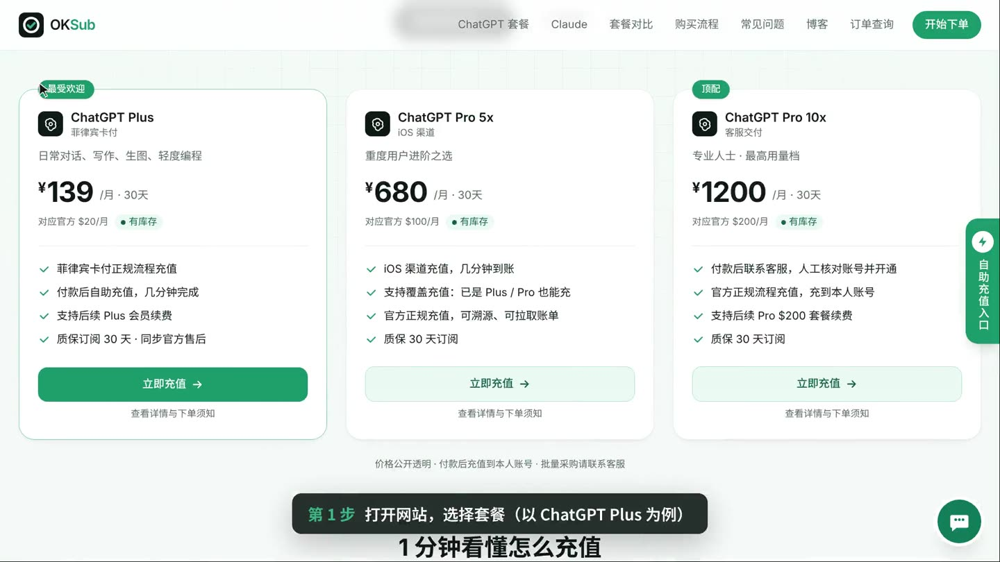

---

### 第 2 步：填写常用邮箱 ✉️

在 **「第一步：填写信息」** 中填写邮箱。

这个邮箱用于接收订单通知与充值链接，**请填写常用邮箱，防止失联**。付款成功后会把订单页链接发到这个邮箱，可随时回来继续充值或查单。

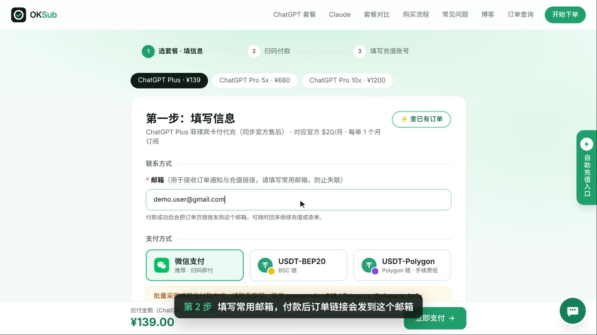

---

### 第 3 步：选择付款方式，点击「立即支付」 💳

选择付款方式：

- **微信支付**：推荐，扫码即付；

- **USDT-BEP20**：BSC 链；

- **USDT-Polygon**：Polygon 链，手续费低。

  需要发票可以在「发票」处选择 **「需要发票」**（每单加收 ¥10）。确认应付金额后点击 **「立即支付」**。

> 💡 批量采购或其他付款方式，请联系客服：微信 `gracereview618` / Telegram `@aispace_kefu`。

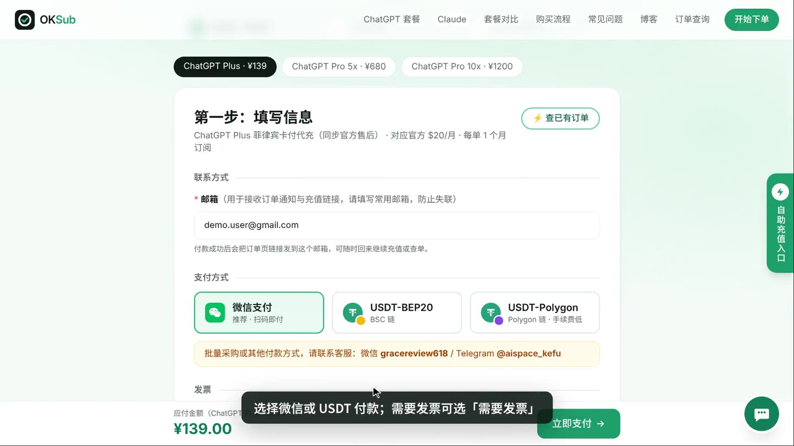

---

### 第 4 步：确认订单，扫码付款 📱

进入 **「确认付款」** 页面，核对套餐、金额、订单号和联系邮箱，然后点击 **「前往安全支付」**，用微信扫码付款（USDT 按页面提示转账）。

请在 **30 分钟内** 完成付款，付款后会自动回到订单页，**不需要截图**。

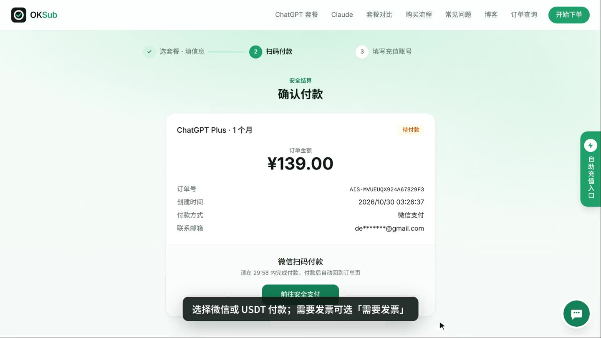

---

### 第 5 步：付款成功，前往充值 🎉

付款到账后页面会显示 **「付款成功！」**，点击 **「前往充值」**。

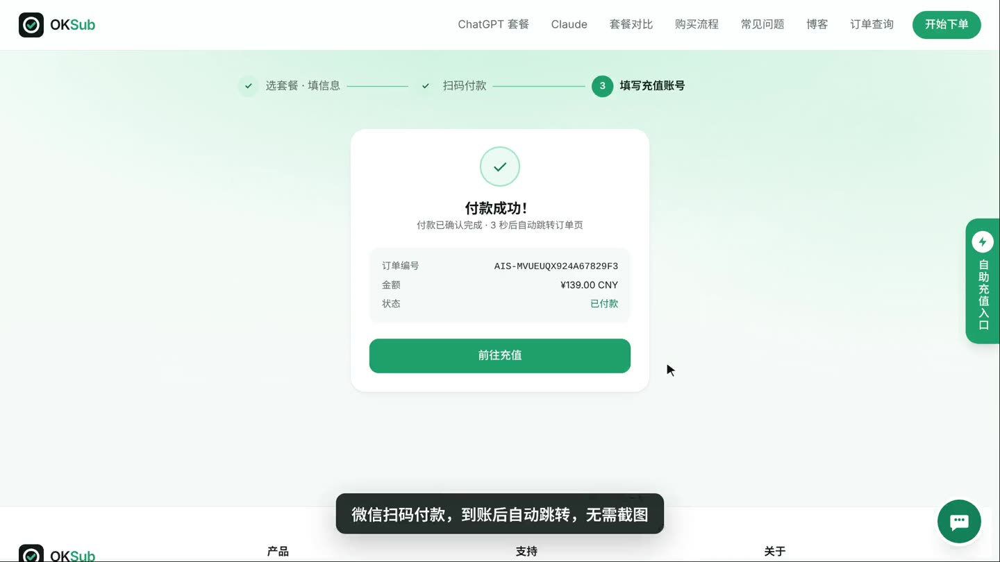

---

### 第 6 步：进入订单页，准备填写充值账号 🧾

进入 **「订单进度」** 页面，可以看到订单状态为 **「已付款」**、下一步为 **「开始充值」**，以及订单号和剩余充值次数。

建议先点 **「复制」** 保存好订单号，后续查单或联系客服都会用到。

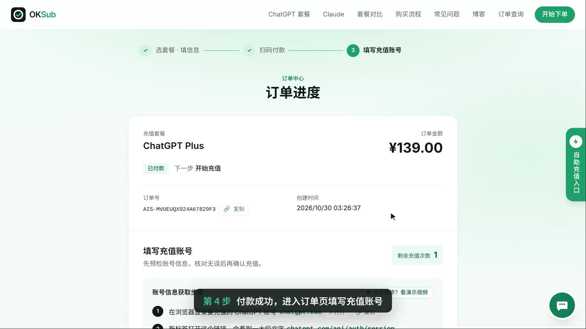

---

### 第 7 步：在已登录 ChatGPT 的浏览器里打开 session 链接 🔗

按订单页「账号信息获取步骤」操作：

1. 在浏览器登录 **你真正准备升级 Plus 的 ChatGPT 账号**：[chatgpt.com](https://chatgpt.com/)；

2. 在 **同一个浏览器** 新标签打开：[chatgpt.com/api/auth/session](https://chatgpt.com/api/auth/session)，会看到一大段文字；

3. 在该页面全选复制，回到订单页粘贴。

   注意：

- 如果 session 页面只显示 `{}`，说明这个浏览器还没登录 ChatGPT，先登录再重新打开链接；

- 用手机操作：请在**手机浏览器**（不是 ChatGPT App）里登录后打开链接，长按文字 → 全选 → 复制；

- 浏览器里同时登录了多个账号时，请先确认当前登录的就是要充值的账号。

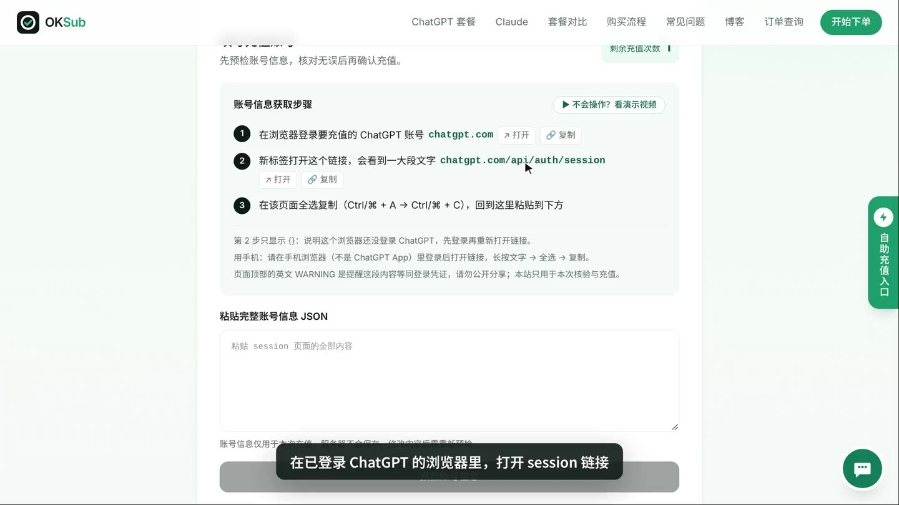

---

### 第 8 步：全选并复制 session 页面的全部内容 📋

session 页面打开后：

- Windows：按 `Ctrl + A` 全选，再按 `Ctrl + C` 复制；

- macOS：按 `Command + A` 全选，再按 `Command + C` 复制。

  一定要复制 **整个页面的完整内容**，不要只复制其中一部分，也不要开启浏览器翻译。

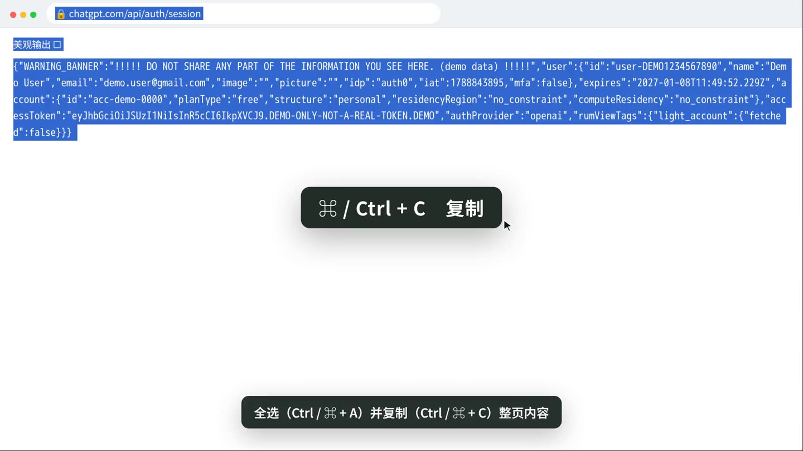

> ⚠️ **这段内容等同登录凭证（含 Access Token），和密码一样敏感。**
>
> 页面顶部的英文 WARNING 就是在提醒这一点。只粘贴到 OKSub 本站订单页，不要截图、不要发给任何人，包括自称客服的人。

---

### 第 9 步：回到订单页粘贴，点「预检账号信息」 🔍

回到订单页，把刚才复制的完整内容粘贴到 **「粘贴完整账号信息 JSON」** 输入框，然后点击 **「预检账号信息」**。

账号信息仅用于本次充值，服务器不会保存；修改内容后需要重新预检。

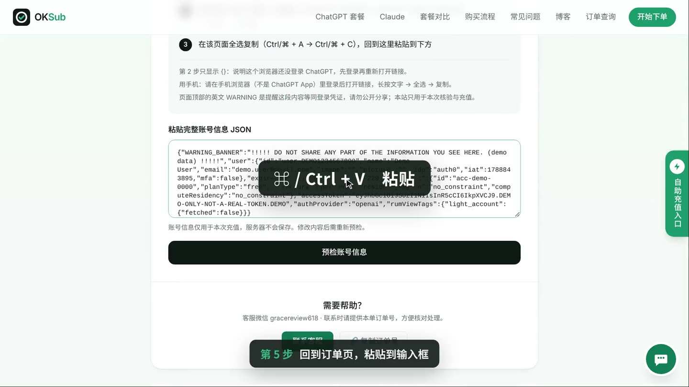

---

### 第 10 步：核对充值账号，确认并开始充值 ✅

预检后会显示 **「核对充值账号」**，请重点检查：

- **账号邮箱** 就是你自己要升级的 ChatGPT 账号；

- **当前套餐** 为 `free`（ChatGPT Plus 仅支持当前为 Free 的账号）；

- **账号类型** 为个人版；

- **充值后套餐** 为 ChatGPT Plus。

  确认无误后勾选 **「我确认这是本次需要充值的账号」**，点击 **「确认并开始充值」**。预检结果有效期 5 分钟，超时请重新预检。

> ⚠️ 提交后请不要关闭页面、退出 ChatGPT 或切换账号，也不要反复重复提交。

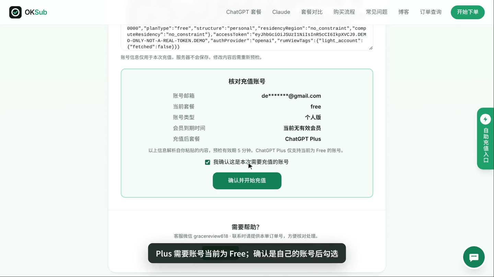

---

### 第 11 步：等待「充值已完成」 🎊

提交后系统自动处理，进度依次为 **提交充值 → 充值处理 → 充值完成**。

看到 **「100% · 充值服务已确认完成」** 就说明充值成功了。

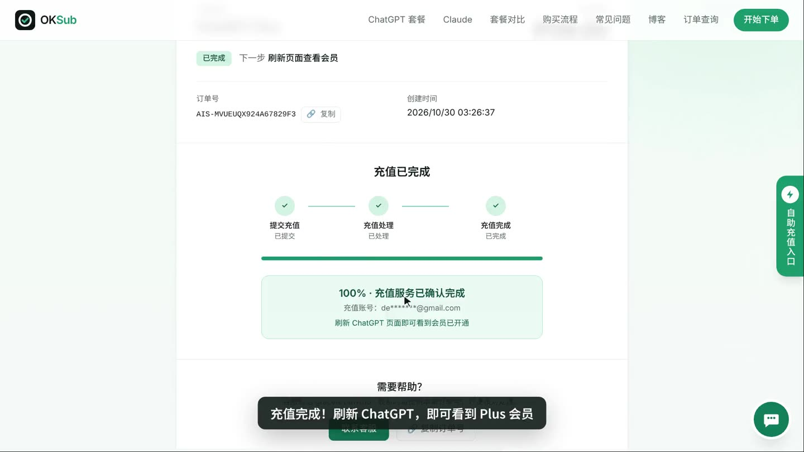

---

### 第 12 步：回到 ChatGPT 确认 Plus 状态 💎

最后重新打开或刷新 ChatGPT。

进入账号设置 / Billing 页面，如果已经从 **ChatGPT Free** 变成 **ChatGPT Plus**，就说明升级成功。

如果刷新后暂时没有变化，可以：

1. 等待几十秒；

2. 刷新页面；

3. 退出 ChatGPT 后重新登录；

4. 再次检查 Billing / 套餐状态。

   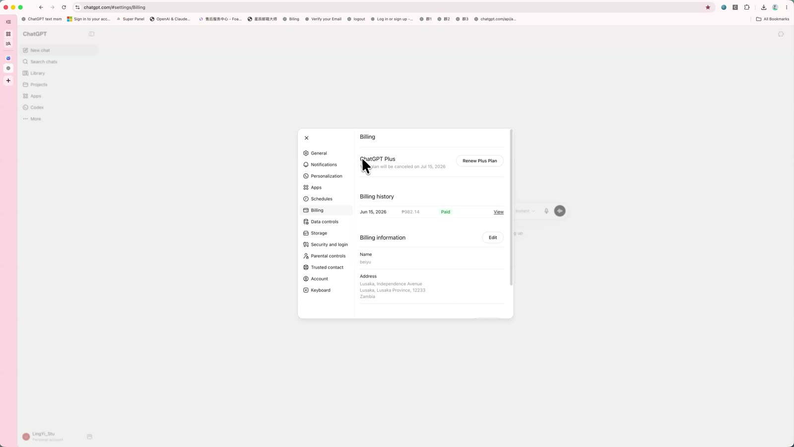

   到这里，整个 ChatGPT Plus 充值流程就完成了。🎊

---

## 5. ❓ ChatGPT Plus 充值常见问题 FAQ

### Q1：ChatGPT 在国内怎么充值？支持哪些付款方式？

支持 **微信支付** 和 **USDT（BEP20 / Polygon）** 付款，无需海外信用卡、PayPal 或虚拟卡。付款后自动进入订单页，粘贴账号信息即可自助充值，通常几分钟完成。

### Q2：充值需要把 ChatGPT 密码给别人吗？

不需要。全程不要账号密码，只需在订单页粘贴 session 页面的内容（含登录凭证 Access Token）完成自助充值。这段内容和密码一样敏感，**只粘贴到本站订单页**，不要截图或发给任何人，包括自称客服的人。

### Q3：充值前账号需要满足什么条件？

ChatGPT Plus 需要账号当前为 **Free** 状态（没有生效中的订阅），不可覆盖已有订阅；Pro 5x 支持覆盖充值，已有 Plus / Pro 也可以充。账号须为个人版，如加入过 Team 空间，请先切回个人账号再复制 session。

### Q4：粘贴后提示「复制不完整」或「无法识别账号」怎么办？

按顺序检查：

1. 打开 session 页面后用 `Ctrl + A`（Mac 用 `⌘ + A`）全选，再 `Ctrl + C` 复制完整内容，不要只复制一部分；

2. 不要开启浏览器翻译；

3. 确认浏览器里登录的就是要充值的那个 ChatGPT 账号；

4. 如果刚才登录过期，刷新 ChatGPT 后重新打开 session 页面再复制。

   仍然不行请联系客服并附上订单号。

### Q5：显示充值完成，但 ChatGPT 还是 Free 怎么办？

可以依次尝试：

1. 刷新 ChatGPT 页面；
2. 等待几十秒后再看；
3. 退出账号重新登录；
4. 打开设置里的 Billing / 套餐页面确认；
5. 仍未生效，请保存订单号联系客服处理。

### Q6：充值失败怎么办？

不要反复重复提交。充值未成功时订单页会显示原因，额度已退回的可以按提示修正后重新提交。

如需客服协助，请提供：

- 订单号；

- 错误提示截图；

- 充值账号邮箱。

  **不要提供密码或 session 内容。**

### Q7：ChatGPT Plus 可以使用 Codex 吗？

可以，Plus 和 Pro 都自带 Codex。建议先在默认浏览器登录好 ChatGPT 账号，再用同一个默认浏览器登录 Codex，这样通常不用再接短信验证码。

### Q8：会充到我自己的账号吗？安全吗？

会。所有套餐都通过官方正规流程充值到你本人账号，不是共享号、不是合租，聊天记录和设置全部保留。粘贴的账号信息仅用于本次核验与充值，请勿公开分享给他人。

### Q9：质保怎么算？

质保订阅 30 天。质保期内如果 Plus / Pro 订阅中途掉了，请及时联系客服（微信 `gracereview618` / Telegram `@aispace_kefu`）并附上订单号处理。如因使用不当导致封号，按 OpenAI 官方售后规则处理。

### Q10：可以开发票吗？

可以。下单时选择「需要发票」（每单加收 ¥10 开票费），付款后在订单页填写抬头和税号（企业或个人均可），开具电子普通发票，开好后在订单页下载并邮件通知，一般 1–3 个工作日。选择不开票的订单之后不支持补开；专票、对公转账请先联系客服。

### Q11：可以一次买多个月吗？

每单为 1 个月订阅。会员到期后重新下单即可续费；需要批量采购请联系客服。

### Q12：下单后在哪里查订单？

付款成功后订单页链接会发到你的下单邮箱；也可以在 [订单查询](https://oksub.net/orders) 页面输入订单号或下单邮箱查询。

---

## 6. **💬 联系客服。**

如果你按照上面的步骤操作后，仍然遇到付款、账号预检、充值结果等问题，可以联系客服协助处理，联系时请附上**订单号**。

### 📱 微信客服

**微信号：`gracereview618`**

### ✈️ Telegram 客服

**[@aispace_kefu](https://t.me/aispace_kefu)**

添加时可以备注：

> ChatGPT Plus 充值 + 订单号

---

## 🎯 最后总结

2026 年，国内外 AI 都已经进入高强度竞争阶段。国产模型越来越强，ChatGPT 也仍然在编程、研究、内容生产和海外工作流中拥有大量用户。

如果你已经有自己的 ChatGPT 账号，只是缺少方便的 Plus 支付方式，那么本教程介绍的流程可以概括成一句话：

> **选套餐 → 微信 / USDT 付款 → 复制 session → 粘贴预检 → 确认充值 → 刷新确认 Plus。**

第一次操作时，不要追求快，尤其要认真检查 **预检显示的账号邮箱和当前套餐**。

### 🚀 相关入口

- OKSub 一体化充值网站：https://oksub.net/

  如果这篇教程对你有帮助，可以 **Star ⭐ / 收藏**，以后续费时直接回来查看。
