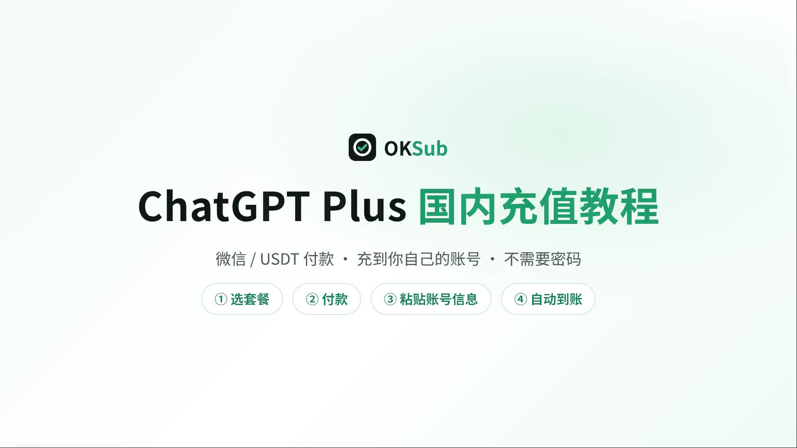

**🌐 Language / 语言:** [简体中文](./README.md) | [English](./README.en.md) | **Русский**

# 🚀 Как оплатить / оформить подписку ChatGPT Plus в 2026 году (пошаговое видео- и фото-руководство для новичков)

> **Руководство по пополнению ChatGPT Plus** для тех, у кого нет международной банковской карты: на универсальном сайте пополнения **[OKSub (oksub.net)](https://oksub.net/)** вы **оплачиваете через WeChat Pay или USDT**, а затем **сами пополняете свой аккаунт ChatGPT** на странице заказа — пароль от аккаунта не нужен. В статье собран полный процесс **с картинками и видео**: выбор тарифа, оплата, копирование данных аккаунта и проверка статуса Plus.
>
> 📅 Последнее обновление: октябрь 2026

## 📌 Ответ в одном предложении: как оплатить ChatGPT Plus без международной карты?

Международная карта не нужна. Откройте **[oksub.net](https://oksub.net/)**, выберите тариф ChatGPT Plus, укажите e-mail и **оплатите через WeChat Pay или USDT**. После оплаты вы автоматически попадёте на страницу заказа. В браузере, где вы вошли в ChatGPT, откройте `chatgpt.com/api/auth/session`, выделите и скопируйте всё содержимое страницы, вставьте его обратно на странице заказа, **выполните предпроверку** почты и текущего тарифа и **подтвердите пополнение**. Через несколько минут обновите ChatGPT — аккаунт перейдёт с **Free на Plus**. Подписка оформляется на ваш собственный аккаунт (не общий и не складчина), история чатов полностью сохраняется, гарантия на подписку — 30 дней.

## 🎬 Видеоурок (полный процесс, ~2 минуты, озвучка на китайском)

Сначала посмотрите весь процесс (около 2 минут), чтобы понять общую картину, а затем следуйте пошаговым инструкциям с картинками ниже.

> ▶️ Нажмите на обложку выше, чтобы воспроизвести видео. Его также можно посмотреть на [главной странице OKSub](https://oksub.net/) или [скачать видеофайл](./plus-tutorial-v2.mp4). Почта и аккаунт в видео — демонстрационные данные.

## 🔗 Быстрые ссылки

| Назначение                                         | Адрес                                   |
| -------------------------------------------------- | --------------------------------------- |
| 🏠 Универсальный сайт OKSub (тариф + оплата + пополнение) | https://oksub.net/                      |
| 🔑 Получить данные аккаунта (session)               | https://chatgpt.com/api/auth/session    |

## 📋 Ключевая информация кратко

| Пункт | Описание |
| --- | --- |
| Для кого | Для тех, у кого уже есть свой аккаунт ChatGPT, но нет международной карты |
| Цена | ChatGPT Plus **¥139 / месяц** (30 дней, соответствует официальным $20/мес.); также доступны Pro 5x ¥680 и Pro 10x ¥1200 |
| Способы оплаты | **WeChat Pay** (рекомендуется, оплата по QR-коду), **USDT-BEP20**, **USDT-Polygon** |
| Как это работает | После оплаты вставьте данные session на странице заказа, выполните предпроверку и пополните сами — обычно за несколько минут |
| Требования к аккаунту | Для Plus аккаунт должен быть сейчас на **Free** (без активной подписки); Pro 5x можно оформить поверх текущего тарифа |
| Нужен ли пароль | Нет, нужно лишь вставить содержимое страницы session на странице заказа |
| История чатов | Полностью сохраняется (повышается ваш собственный аккаунт) |
| Гарантия | 30 дней на подписку; если Plus слетит, обратитесь в поддержку |
| Счёт / фапяо | Можно получить электронный счёт (при заказе выберите «需要发票», +¥10 за заказ) |
| Можно ли пользоваться Codex | Да |
| Поддержка | WeChat `gracereview618` / Telegram `@aispace_kefu` |

---

## 1. 🌍 Введение: почему в 2026 году многим пользователям всё ещё нужен ChatGPT Plus?

### Почему пользователям без международной карты сложно оплатить ChatGPT Plus?

Для многих настоящая сложность — не «умею ли я пользоваться ChatGPT», а **как оформить подписку Plus**.

Типичные проблемы:

- Нет подходящего международного способа оплаты;

- Незнаком процесс оплаты зарубежной банковской картой;

- Регион аккаунта App Store / Google Play не совпадает;

- Раньше нужно было купить код в одном магазине, а пополнять на другом сайте — больше шагов и больше шансов ошибиться.

  Процесс ниже использует **универсальный сайт пополнения OKSub**: выбор тарифа, оплата и пополнение происходят на одном сайте, а после оплаты вы сразу попадаете на страницу заказа и пополняете аккаунт сами. Рекомендуется выполнять все действия в браузере на компьютере.

---

## 2. 👥 Кому подходит этот способ оплаты ChatGPT Plus?

Это руководство хорошо подойдёт следующим пользователям:

### ✅ У вас уже есть свой аккаунт ChatGPT

Не нужно покупать «готовый аккаунт» — вы повышаете до Plus свой собственный аккаунт, а история чатов и повседневное использование остаются в нём.

### ✅ У вас нет удобной международной карты

Если вы не можете оплатить картой на официальной странице ChatGPT, можно оплатить через WeChat Pay или USDT.

### ✅ Вы делаете это впервые и хотите иметь руководство для сверки

Весь процесс можно описать так:

**Выбрать тариф → Указать e-mail → Оплатить WeChat / USDT → Скопировать данные session → Вставить и выполнить предпроверку → Подтвердить пополнение → Обновить ChatGPT и увидеть Plus**

Если процесс незнаком — не страшно, просто следуйте скриншотам ниже шаг за шагом.

---

## 3. 🧰 Что нужно для пополнения ChatGPT Plus?

Перед началом рекомендуется подготовить следующее.

### ① Аккаунт ChatGPT, в который вы можете войти

Сначала откройте ChatGPT в браузере и убедитесь, что:

- Вход выполняется нормально;

- Почта — это тот аккаунт, который вы хотите повысить;

- Текущий тариф — **Free** (Plus можно оформить только на аккаунт без активной подписки);

- Это личный аккаунт: если вы вступали в рабочее пространство Team, сначала переключитесь на личный аккаунт.

### ② E-mail, которым вы регулярно пользуетесь

При заказе нужно указать e-mail. После оплаты ссылка на страницу заказа придёт на эту почту, чтобы вы могли в любой момент вернуться и продолжить пополнение или проверить заказ.

### ③ WeChat Pay или USDT

Рекомендуется оплата WeChat по QR-коду; также поддерживаются USDT-BEP20 (сеть BSC) и USDT-Polygon (низкая комиссия).

---

## 4. 🖼️ Пошаговые действия с картинками

Переходим к самому пополнению. Посмотрев видео выше, разверните полные пошаговые инструкции ниже, если хотите сверить каждую деталь.

📖 Нажмите, чтобы развернуть полную пошаговую инструкцию (12 шагов)

### Шаг 1: Откройте OKSub и выберите тариф ChatGPT Plus 🚪

Откройте:

👉 [https://oksub.net/](https://oksub.net/)

В разделе «ChatGPT 套餐» (тарифы ChatGPT) найдите **ChatGPT Plus (¥139 / месяц · 30 дней)** и нажмите **«立即充值»** (Пополнить сейчас).

Можно также сразу открыть страницу заказа: [https://oksub.net/checkout/chatgpt-plus](https://oksub.net/checkout/chatgpt-plus)

---

### Шаг 2: Укажите e-mail, которым регулярно пользуетесь ✉️

В блоке **«第一步：填写信息»** (Шаг 1: заполните данные) укажите e-mail.

На эту почту приходят уведомления о заказе и ссылка для пополнения — **укажите почту, которую регулярно проверяете, чтобы не потерять связь**. После оплаты сюда будет отправлена ссылка на страницу заказа, чтобы вы могли в любой момент вернуться и продолжить или проверить заказ.

---

### Шаг 3: Выберите способ оплаты и нажмите «立即支付» (Оплатить) 💳

Выберите способ оплаты:

- **微信支付 (WeChat Pay)**: рекомендуется, оплата по QR-коду;

- **USDT-BEP20**: сеть BSC;

- **USDT-Polygon**: сеть Polygon, низкая комиссия.

  Если нужен счёт, в разделе «发票» выберите **«需要发票»** (Нужен счёт, +¥10 за заказ). Проверьте сумму к оплате и нажмите **«立即支付»** (Оплатить).

> 💡 Для оптовых покупок или других способов оплаты свяжитесь с поддержкой: WeChat `gracereview618` / Telegram `@aispace_kefu`.

---

### Шаг 4: Подтвердите заказ и оплатите 📱

На странице **«确认付款»** (Подтверждение оплаты) проверьте тариф, сумму, номер заказа и контактную почту, затем нажмите **«前往安全支付»** (Перейти к безопасной оплате) и отсканируйте QR-код в WeChat (для USDT переведите средства по инструкции на странице).

**Оплатите в течение 30 минут.** После оплаты вы автоматически вернётесь на страницу заказа — **скриншот не нужен**.

---

### Шаг 5: Оплата прошла — переходите к пополнению 🎉

Когда оплата поступит, на странице появится **«付款成功！»** (Оплата прошла успешно). Нажмите **«前往充值»** (Перейти к пополнению).

---

### Шаг 6: Откройте страницу заказа и подготовьтесь указать аккаунт 🧾

На странице **«订单进度»** (Статус заказа) вы увидите статус **«已付款»** (Оплачено), следующий шаг **«开始充值»** (Начать пополнение), номер заказа и оставшееся количество пополнений.

Сначала нажмите **«复制»** (Копировать) и сохраните номер заказа — он понадобится для поиска заказа или обращения в поддержку.

---

### Шаг 7: Откройте ссылку session в браузере, где вы вошли в ChatGPT 🔗

Следуйте блоку «账号信息获取步骤» (Как получить данные аккаунта) на странице заказа:

1. Войдите в браузере в **тот аккаунт ChatGPT, который действительно хотите повысить до Plus**: [chatgpt.com](https://chatgpt.com/);

2. В **том же браузере** откройте новую вкладку: [chatgpt.com/api/auth/session](https://chatgpt.com/api/auth/session) — вы увидите большой блок текста;

3. Выделите всё на этой странице, скопируйте и вставьте на странице заказа.

   Обратите внимание:

- Если страница session показывает только `{}`, значит, в этом браузере вы ещё не вошли в ChatGPT — сначала войдите, затем снова откройте ссылку;

- С телефона: войдите через **мобильный браузер** (не приложение ChatGPT), откройте ссылку, долгое нажатие на текст → Выделить всё → Копировать;

- Если в браузере одновременно выполнен вход в несколько аккаунтов, убедитесь, что текущий — тот, который нужно пополнить.

---

### Шаг 8: Выделите и скопируйте всё содержимое страницы session 📋

Когда страница session откроется:

- Windows: нажмите `Ctrl + A`, чтобы выделить всё, затем `Ctrl + C`, чтобы скопировать;

- macOS: нажмите `Command + A`, затем `Command + C`.

  Обязательно скопируйте **всё содержимое страницы целиком**, а не его часть, и не включайте перевод страницы в браузере.

> ⚠️ **Это содержимое равнозначно учётным данным для входа (включает Access Token) и так же конфиденциально, как пароль.**
>
> Английское WARNING вверху страницы предупреждает именно об этом. Вставляйте его только на свою страницу заказа OKSub — не делайте скриншоты и не отправляйте никому, в том числе тем, кто представляется поддержкой.

---

### Шаг 9: Вставьте содержимое на странице заказа и нажмите «预检账号信息» (Предпроверка) 🔍

Вернитесь на страницу заказа, вставьте всё скопированное в поле **«粘贴完整账号信息 JSON»** (Вставьте полный JSON с данными аккаунта) и нажмите **«预检账号信息»** (Предпроверка данных аккаунта).

Данные аккаунта используются только для этого пополнения и не сохраняются на сервере; если вы измените содержимое, выполните предпроверку заново.

---

### Шаг 10: Проверьте аккаунт, подтвердите и начните пополнение ✅

После предпроверки появится блок **«核对充值账号»** (Проверка аккаунта для пополнения). Внимательно проверьте:

- **Почта аккаунта** — это ваш собственный аккаунт ChatGPT, который нужно повысить;

- **Текущий тариф** — `free` (ChatGPT Plus поддерживает только аккаунты, которые сейчас на Free);

- **Тип аккаунта** — личный;

- **Тариф после пополнения** — ChatGPT Plus.

  Если всё верно, отметьте **«我确认这是本次需要充值的账号»** (Подтверждаю, что это нужный аккаунт) и нажмите **«确认并开始充值»** (Подтвердить и начать пополнение). Результат предпроверки действителен 5 минут — по истечении выполните её снова.

> ⚠️ После отправки не закрывайте страницу, не выходите из ChatGPT, не переключайте аккаунт и не отправляйте запрос повторно.

---

### Шаг 11: Дождитесь «充值已完成» (Пополнение завершено) 🎊

После отправки система обработает запрос автоматически: **Отправлено → Обработка → Завершено**.

Когда появится **«100% · 充值服务已确认完成»** (100% · пополнение подтверждено), пополнение успешно выполнено.

---

### Шаг 12: Вернитесь в ChatGPT и подтвердите статус Plus 💎

Наконец, заново откройте или обновите ChatGPT.

Перейдите в настройки аккаунта / Billing. Если вместо **ChatGPT Free** отображается **ChatGPT Plus**, повышение прошло успешно.

Если после обновления изменений пока нет, можно:

1. Подождать несколько десятков секунд;

2. Обновить страницу;

3. Выйти из ChatGPT и войти снова;

4. Ещё раз проверить Billing / статус тарифа.

   

   Вот и всё — процесс пополнения ChatGPT Plus завершён. 🎊

---

## 5. ❓ Частые вопросы по пополнению ChatGPT Plus (FAQ)

### В1: Как оплатить ChatGPT без международной карты? Какие способы оплаты поддерживаются?

Поддерживаются **WeChat Pay** и **USDT (BEP20 / Polygon)** — зарубежная карта, PayPal или виртуальная карта не нужны. После оплаты вы сразу попадаете на страницу заказа, вставляете данные аккаунта и пополняете сами, обычно за несколько минут.

### В2: Нужно ли кому-то передавать пароль от ChatGPT?

Нет. Пароль не нужен ни на одном этапе — вы лишь вставляете на странице заказа содержимое страницы session (оно содержит учётные данные Access Token). Это содержимое так же конфиденциально, как пароль: **вставляйте его только на странице заказа этого сайта**, не делайте скриншоты и никому не отправляйте, в том числе тем, кто представляется поддержкой.

### В3: Каким условиям должен соответствовать аккаунт перед пополнением?

Для ChatGPT Plus аккаунт должен быть сейчас на **Free** (без активной подписки), поверх существующей подписки оформить нельзя; Pro 5x можно оформить поверх — подходят аккаунты уже с Plus / Pro. Аккаунт должен быть личным: если вы вступали в рабочее пространство Team, перед копированием session переключитесь на личный аккаунт.

### В4: Я уже на Plus — можно ли продлить?

Досрочно продлить Plus нельзя: Plus оформляется только на аккаунты со статусом Free, поэтому дождитесь окончания текущей подписки и возврата аккаунта на Free, затем закажите снова. Если хотите перейти на более высокий тариф, Pro 5x можно оформить прямо на аккаунт с Plus.

### В5: После вставки пишет «скопировано не полностью» или «не удаётся распознать аккаунт». Что делать?

Проверьте по порядку:

1. На странице session нажмите `Ctrl + A` (на Mac `⌘ + A`), затем `Ctrl + C`, чтобы скопировать всё содержимое, а не его часть;

2. Не включайте перевод страницы в браузере;

3. Убедитесь, что в браузере выполнен вход именно в тот аккаунт ChatGPT, который нужно пополнить;

4. Если сессия только что истекла, обновите ChatGPT, снова откройте страницу session и скопируйте заново.

   Если не помогло, обратитесь в поддержку и укажите номер заказа.

### В6: Пишет, что пополнение завершено, но ChatGPT всё ещё Free. Что делать?

Попробуйте по порядку:

1. Обновить страницу ChatGPT;
2. Подождать несколько десятков секунд и проверить снова;
3. Выйти из аккаунта и войти снова;
4. Открыть Billing / тариф в настройках и проверить;
5. Если всё ещё не активно, сохраните номер заказа и обратитесь в поддержку.

### В7: Что делать, если пополнение не удалось?

Не отправляйте запрос повторно снова и снова. Если пополнение не прошло, на странице заказа будет указана причина; если лимит возвращён, исправьте проблему по подсказке и отправьте снова.

Если нужна помощь поддержки, предоставьте:

- Номер заказа;

- Скриншот сообщения об ошибке;

- Почту пополняемого аккаунта.

  **Не передавайте пароль или содержимое session.**

### В8: Можно ли с ChatGPT Plus пользоваться Codex?

Да, и в Plus, и в Pro есть Codex. Сначала войдите в ChatGPT в браузере по умолчанию, затем войдите в Codex через тот же браузер — так обычно не понадобится SMS-код.

### В9: Пополнится ли именно мой аккаунт? Это безопасно?

Да. Все тарифы оформляются на ваш собственный аккаунт через официальный легальный процесс — это не общий аккаунт и не складчина, история чатов и настройки полностью сохраняются. Вставленные данные аккаунта используются только для этой проверки и пополнения; не публикуйте их.

### В10: Как работает гарантия?

Гарантия на подписку — 30 дней. Если в течение гарантийного срока подписка Plus / Pro слетит, своевременно обратитесь в поддержку (WeChat `gracereview618` / Telegram `@aispace_kefu`) и укажите номер заказа. Блокировки из-за ненадлежащего использования рассматриваются по официальным правилам OpenAI.

### В11: Можно ли получить счёт (фапяо)?

Да. При заказе выберите «需要发票» (Нужен счёт, +¥10 за заказ); после оплаты укажите на странице заказа название и налоговый номер (компания или физлицо). Выставляется электронный обычный счёт, его можно скачать на странице заказа, также придёт уведомление на почту — обычно в течение 1–3 рабочих дней. Для заказов без счёта выставить его позже нельзя; по специальным счетам НДС и оплате с расчётного счёта компании сначала свяжитесь с поддержкой.

### В12: Можно ли купить сразу несколько месяцев?

Каждый заказ — подписка на 1 месяц. По истечении просто оформите новый заказ для продления; для оптовых покупок свяжитесь с поддержкой.

### В13: Где посмотреть заказ?

После оплаты ссылка на страницу заказа приходит на почту, указанную при заказе; также можно найти заказ на странице [Поиск заказа](https://oksub.net/orders) по номеру заказа или e-mail.

---

## 6. 💬 Связь с поддержкой

Если после выполнения шагов выше у вас остались проблемы с оплатой, предпроверкой аккаунта или результатом пополнения, обратитесь в поддержку — пожалуйста, укажите **номер заказа**.

### 📱 Поддержка в WeChat

**WeChat ID: `gracereview618`**

### ✈️ Поддержка в Telegram

**[@aispace_kefu](https://t.me/aispace_kefu)**

При добавлении можно указать примечание:

> Пополнение ChatGPT Plus + номер заказа

---

## 🎯 Итог

В 2026 году ИИ в Китае и за рубежом вступил в фазу жёсткой конкуренции. Отечественные модели становятся всё сильнее, а у ChatGPT по-прежнему огромная аудитория в программировании, исследованиях, создании контента и международных рабочих процессах.

Если у вас уже есть свой аккаунт ChatGPT и не хватает лишь удобного способа оплатить Plus, процесс из этого руководства можно описать одной строкой:

> **Выбрать тариф → Оплатить WeChat / USDT → Скопировать session → Вставить и выполнить предпроверку → Подтвердить пополнение → Обновить и убедиться, что Plus активен.**

В первый раз не торопитесь — особенно внимательно проверьте **почту аккаунта и текущий тариф, показанные при предпроверке**.

### 🚀 Полезные ссылки

- Универсальный сайт пополнения OKSub: https://oksub.net/

- Сразу оформить ChatGPT Plus: https://oksub.net/checkout/chatgpt-plus

- Поиск заказа: https://oksub.net/orders

- Демо-видео: [plus-tutorial-v2.mp4](./plus-tutorial-v2.mp4)

  Если руководство было полезным, поставьте **Star ⭐ / добавьте в закладки**, чтобы вернуться к нему при следующем продлении.
